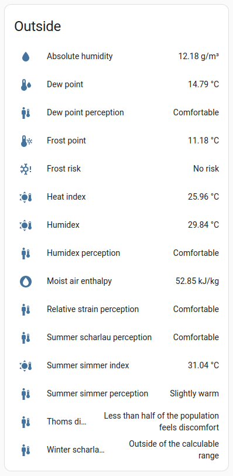

# [](https://github.com/dolezsa/thermal_comfort)
[](https://github.com/hacs/integration)


Thermal Comfort provides a variety of thermal indices and thermal perceptions including feels like temperatures in numeric and textual representation for Home Assistant.

## Sensors:

**[Full list](https://github.com/dolezsa/thermal_comfort/blob/master/documentation/sensors.md)**

### Numeric Indices

Thermal Comfort provides numerical indices like `dew point`, `frost point`, `absolute humidity` and `moist air enthalpy` that are numeric values usable for further automations but also human readable. e.g. dew point tells the temperature to which air must be cooled to produce dew on a surface.

### Bio Indices / Perception

Thermal Comfort also provides a variety of bio indices like `humidex` or `heat index` giving numeric values of human perceived temperatures (feels like temperature). In addition we also provide textual perception sensors that describe the range of an index in human readable form e.g. comfortable or uncomfortable.
With an optional wind speed sensor, it also provides the `wind chill` and the `apparent temperature` of the outdoor air.



## Usage
To use Thermal Comfort check the documentation for your preferred way to setup
sensors.

**[UI/Frontend (Config Flow)](https://github.com/dolezsa/thermal_comfort/blob/master/documentation/config_flow.md)**

**[YAML](https://github.com/dolezsa/thermal_comfort/blob/master/documentation/yaml.md)**

## Installation

### Requirements

Home Assistant 2025.8.0 or newer (which needs Python 3.13 or newer).

Older Home Assistant versions can keep using the 2.2 releases (Home Assistant
2023.12.0 or newer,
 [documentation](https://github.com/dolezsa/thermal_comfort/tree/2.2/documentation))
or the 1.5 releases for even older versions
 ([documentation](https://github.com/dolezsa/thermal_comfort/tree/1.5/documentation)).

### Using [HACS](https://hacs.xyz/) (recommended)

This integration can be installed using HACS. Open HACS, search for Thermal Comfort, download it and restart Home Assistant.

### Manual

To install this integration manually you can either

* Use git:

```sh
git clone https://github.com/dolezsa/thermal_comfort.git
cd thermal_comfort
# if you want a specific version checkout its tag
# e.g. git checkout 1.0.0

# replace $hacs_config_folder with your home assistant config folder path
cp -r custom_components $hacs_config_folder
```

* Download `thermal_comfort.zip` from the [latest release](https://github.com/dolezsa/thermal_comfort/releases/latest) and extract it into the `custom_components/thermal_comfort` folder of your Home Assistant config folder.

Finally you need to restart home assistant before you can use it.

### Custom Icons
The dew point, frost point and perception sensors have their own icons, the `tc:` icon set of the
[Thermal Comfort icon pack](https://github.com/rautesamtr/thermal_comfort_icons). The icons come with the
integration, there is nothing to install. Sensors of a device created in the UI use them by default.

To use the standard Home Assistant icons instead, switch off "Use custom icons" in the advanced options of the
 [device](https://github.com/dolezsa/thermal_comfort/blob/master/documentation/config_flow.md#configuration-options).
In [yaml](https://github.com/dolezsa/thermal_comfort/blob/master/documentation/yaml.md#sensor-configuration-variables)
the standard icons are used unless `custom_icons` is set to `true`.

* The separate icon pack from HACS is not needed any more, you can remove it. If it stays installed nothing breaks.
* If an icon stays empty after the update, reload the page of the browser (or clear its cache). Surfaces that do not use
  the Home Assistant frontend, such as some widgets of the mobile apps, may not show custom icons.

## Upgrading from 3.1

* The icons of the former icon pack are built in. Devices created in the UI from now on use them by default; existing
  devices and YAML sensors keep their setting (`custom_icons`). The separate icon pack can be removed, see
  [Custom Icons](#custom-icons).

* With an optional outdoor temperature and humidity sensor (a weather entity works too) a device also has the
  moisture excess, the ventilation advice and the ventilation need, see the
  [documentation](https://github.com/dolezsa/thermal_comfort/blob/master/documentation/ventilation.md). Without them nothing changes.
* Weather and climate entities can be a source of the temperature and the humidity, their
  attributes are used. Other entities can be used with the attribute options in the advanced
  options. A configuration that already uses a weather entity starts to work without a change.
* The entity IDs of new sensors are in English also if Home Assistant uses a language with native entity IDs,
  they used to be translated. Existing entities keep their entity ID.
* With an optional wind speed sensor (a weather entity works too) a device also has the wind chill and the
  apparent temperature, meant for a device of the outdoor air, see the
  [documentation](https://github.com/dolezsa/thermal_comfort/blob/master/documentation/sensors.md#wind). Without it nothing changes.
* New sensors: the wet-bulb temperature, the Thoms discomfort index, the humidity ratio and the vapor pressure
  deficit. Sensors configured in the frontend before the update get them as disabled entities, enable them in
  the entity settings. YAML sensors without `sensor_types` get them automatically.
* The Thoms discomfort perception and its `thoms_discomfort_index` attribute use the relative humidity
  form of the index, the one the categories belong to, instead of the mean of the air and wet-bulb
  temperature. The values change (see the [sensor documentation](https://github.com/dolezsa/thermal_comfort/blob/master/documentation/sensors.md)),
  so does the state of the perception near the category limits. The previous value is in the
  `epstein_moran_discomfort_index` attribute of the new index sensor.
* The sensors with a temperature device class (dew point, frost point, heat index, humidex, summer simmer index,
  wet-bulb temperature, wind chill and apparent temperature) have the `diagnostic` entity category, so they no longer count for the temperature of
  an area. They are shown in the diagnostic section of the device.

## Upgrading from 2.x to 3.0

* Home Assistant 2025.8.0 or newer is required.
* The calculated sensors are `unavailable` while a source sensor is unavailable, unknown or out of range
  (see [input values](https://github.com/dolezsa/thermal_comfort/blob/master/documentation/sensors.md#input-values)),
  instead of keeping the last value. They also start as `unavailable` instead of `unknown` until both sources are valid.
  Adjust automations or templates that relied on the old behavior.
* Humidity readings up to 105 % are treated as 100 %.
* Corrected formulas change the values of two attributes: `thoms_discomfort_index` (typically about 0.4 to 1.1 °C
  higher at 40 to 70 % humidity, more at higher humidity) and, from 3.0.1 on, `winter_scharlau_index`.
  The state of the Thom's discomfort and winter Scharlau perception sensors changes with them.
* Polling, the poll interval, custom icons and the enabled sensors are in a collapsed "Advanced options" section,
  advanced mode is no longer needed. Existing entries keep working unchanged.
* Any sensor entity can be chosen as a temperature or humidity source, sensors with a matching device class are listed first.
* The absolute humidity sensor has the `absolute_humidity` device class, and the `temperature` and `humidity`
  attributes are no longer stored in the recorder.

## Localization 🌎🗺
Contribute translations directly with PRs or with the inlang editor
[Fink](https://fink.inlang.com/github.com/dolezsa/thermal_comfort).

## Support and Contributing
Please report bugs and ask questions in the [issues](https://github.com/dolezsa/thermal_comfort/issues),
see [CONTRIBUTING.md](CONTRIBUTING.md) if you want to contribute.
Thermal Comfort is licensed under the [MIT license](LICENSE), credits are listed in [CREDITS.md](CREDITS.md).
Exceptions: the bundled `tc:` icons are licensed under Apache-2.0 (modified Material Design Icons, loader code MIT, see
[custom_components/thermal_comfort/www/LICENSE](custom_components/thermal_comfort/www/LICENSE) and
[ATTRIBUTION.md](custom_components/thermal_comfort/www/ATTRIBUTION.md)), and the artwork in the `icons` folder is
licensed under CC BY-NC-SA 4.0 (see [icons/LICENCE.md](icons/LICENCE.md)).
